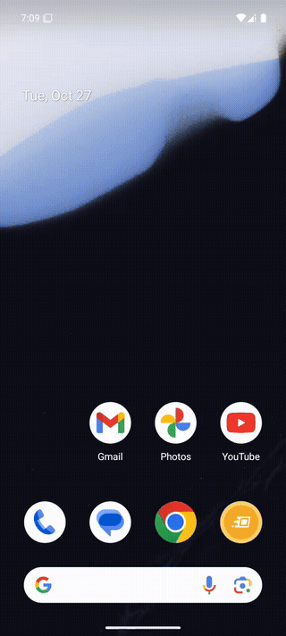

# Android Emulator Kit

**Depure seu site no Chrome de um Android de verdade, com DevTools completo, em um comando PowerShell.**
Sem Android Studio, sem admin, funciona atrás de proxy corporativo e inspeção SSL.

> **Somente Windows** (PowerShell 5.1+, Windows Hypervisor Platform). [Read in English](README.md).

```powershell
.\setup.ps1                  # 1x: baixa SDK + imagem Android 15 (~1,5 GB) e cria o emulador
.\open.ps1 localhost:3000    # sobe o emulador, abre seu dev server no Chrome dele e o chrome://inspect no PC
```

<p align="center">
  
</p>

## Por quê

- **Seu `localhost` funciona no celular.** O `open.ps1` encaminha a porta com `adb reverse`, então a página mantém a
  origem `localhost` (contexto seguro: service workers, geolocalização, câmera etc.).
- **WebViews de builds release são inspecionáveis.** A imagem é `google_apis` (*userdebug*), então WebViews de qualquer
  app aparecem no `chrome://inspect`, não só de builds debug.
- **Tudo fica no seu perfil de usuário.** Um JDK portátil é baixado se você não tiver Java 17+. O único passo que pode
  precisar da TI é habilitar o hipervisor.
- **Rede corporativa é prioridade.** Suporte a proxy e certificado raiz próprio, sem alterar o Java do sistema.

Se você já usa o Device Manager do Android Studio, não precisa deste kit.

## Pré-requisitos (uma vez)

1. **Windows Hypervisor Platform** habilitado (precisa de admin e reinício):
   `Enable-WindowsOptionalFeature -Online -FeatureName HypervisorPlatform`.
   O `setup.ps1` verifica e avisa se faltar.
2. ~8 GB livres em disco (SDK + imagem + AVD).
3. Rede corporativa? Defina antes de rodar o setup (no mesmo terminal):
   ```powershell
   $env:HTTPS_PROXY  = 'http://proxy.empresa:8080'     # se houver proxy
   $env:CORP_CA_CERT = 'C:\certs\empresa-root-ca.cer'  # se a rede faz inspeção SSL
   ```
   Para obter o certificado: abra qualquer site HTTPS no navegador → cadeado → Certificado → exporte o certificado
   **raiz** (Base-64 .cer).

Se o PowerShell recusar rodar scripts baixados, desbloqueie a pasta: `Get-ChildItem -Recurse | Unblock-File`.

## Uso

### Depurar um site

```powershell
.\open.ps1 localhost:3000            # seu dev server (porta encaminhada automaticamente)
.\open.ps1 https://exemplo.com       # qualquer URL pública
.\open.ps1 localhost:5173 -NoInspector
```

Depois clique em **inspect** abaixo da aba no `chrome://inspect` (usa o Edge se o Chrome não estiver instalado) para ter
console, rede, DOM e performance da página rodando no Android.

Portas abaixo de 1024 (ex.: `localhost:80`) não podem ser encaminhadas; o script usa `10.0.2.2`, que é o PC visto de
dentro do emulador.

### Emulador

```powershell
.\start.ps1              # sobe (não faz nada se já estiver rodando); -Wipe reseta, -Headless sem janela
```

O kit sempre usa `emulator-5554`, então continua funcionando com um celular físico conectado.

### Depurar um app

```powershell
.\inspect.ps1 webview -Package com.exemplo.app  # confirma WebView ativa e abre o chrome://inspect
.\inspect.ps1 webview                           # lista todos os alvos do DevTools (Chrome + WebViews de apps)
.\inspect.ps1 logs    -Package com.exemplo.app  # logcat só do app, salvo em out\ (sobrevive a reinícios do app)
.\inspect.ps1 crash                             # crashes + ANRs recentes com stack trace
.\inspect.ps1 ui                                # árvore de UI (XML) + screenshot em out\
.\inspect.ps1 record                            # grava a tela em out\ (Enter para parar; o Android limita a 3 min)
```

- Para descobrir o pacote: `adb shell pm list packages -3`.
- Tudo que os scripts geram (logs, screenshots, gravações) fica em `out\`, que está no `.gitignore`.
- Apps **React Native / Flutter** puros não usam WebView; use `ui`, `logs` e `crash`.
- Arraste um `.apk` para a janela do emulador para instalar direto.

### Instalar um beta do Firebase App Distribution

1. No emulador, abra o **Chrome** e faça login com a conta Google convidada para o beta.
2. Abra o link do e-mail de convite do Firebase → aceite → baixe e instale o **App Tester**.
3. Pelo App Tester, instale o build.

## Problemas comuns

| Sintoma | Causa / solução |
|---|---|
| `accel-check` falha | Habilitar *Windows Hypervisor Platform* e reiniciar |
| `Error on ZipFile unknown archive` | `cmdline-tools` antigo (≤ 12) não abre as imagens novas. Rode `setup.ps1`, que atualiza para o Android CLI |
| Download com erro SSL/PKIX | Definir `CORP_CA_CERT` e rodar `setup.ps1` de novo |
| Download falha/timeout | Definir `HTTPS_PROXY`; pedir à TI liberação de `dl.google.com` e `api.adoptium.net` |
| Boot não termina | `.\start.ps1 -TimeoutSec 600` em máquinas lentas; senão `.\start.ps1 -Wipe` |
| App fecha ou diz "dispositivo não suportado" | App usa Play Integrity/detecção de emulador; só em aparelho físico |
| Emulador lento | Feche outras VMs; confirme GPU `auto` e 4 GB RAM em `~\.android\avd\beta-tester.avd\config.ini` |
| Estado bagunçado | `.\start.ps1 -Wipe` |

## O que o setup altera na sua máquina

- Android SDK em `%LOCALAPPDATA%\Android\Sdk` (ou `ANDROID_HOME`), AVD em `~\.android\avd`.
- JDK portátil e cópia do truststore com o certificado corporativo (se necessário) em `%LOCALAPPDATA%\android-kit`.
- `ANDROID_HOME` e entradas no `PATH` do usuário para `platform-tools`, `emulator` e `cmdline-tools`.
- Dentro do emulador, o `open.ps1` grava flags do Chrome que pulam as telas de primeiro uso e marca o Chrome como app
  de debug persistente (`am set-debug-app --persistent`). `.\start.ps1 -Wipe` desfaz os dois.

## Configuração

Versão do Android, nome do AVD, RAM, porta do emulador etc. ficam em [`config.ps1`](config.ps1).

## Licença

[MIT](LICENSE)
